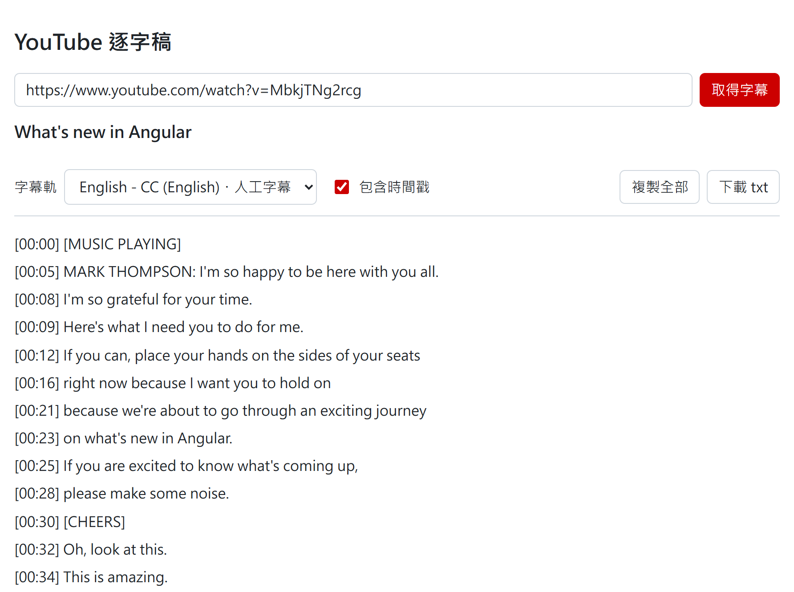
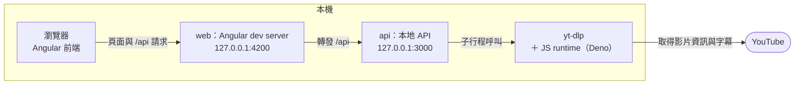

# ngx-youtube-transcript

在本機執行的 YouTube 逐字稿檢視器。貼上影片網址，透過 yt-dlp 取得字幕，以「時間戳＋文字」逐行顯示，可以複製全部或下載成 txt

<picture>
  <source media="(prefers-color-scheme: dark)" srcset="docs/images/main-dark.png">
  
</picture>

<sub>範例影片：[What's new in Angular](https://www.youtube.com/watch?v=MbkjTNg2rcg)（創用 CC 授權）</sub>

## 需求

- Node.js 24 以上（後端直接執行 TypeScript）
- [yt-dlp](https://github.com/yt-dlp/yt-dlp)，需在 PATH 中，例如 `winget install yt-dlp`
- yt-dlp 抓 YouTube 時需要 JS runtime，例如 `winget install DenoLand.Deno`

## 使用方式

```sh
npm install
npm start
```

開啟 http://127.0.0.1:4200 即可使用。`npm start` 會同時啟動：

- `web`：Angular dev server，port 4200，把 `/api` 轉發給後端
- `api`：本地 API，只監聽 `127.0.0.1:3000`；啟動時找不到 yt-dlp 會直接結束

抓取失敗時，最常見的原因是 yt-dlp 版本太舊，請先更新 yt-dlp

## 架構



所有元件都在本機執行，只有 yt-dlp 會連到 YouTube。前端取得一份逐字稿會依序呼叫兩支 API：

1. `GET /api/video?url=…`：以 `yt-dlp -J` 讀取影片標題、長度與字幕軌清單，並挑出預設字幕軌（人工字幕優先）
2. `GET /api/transcript?url=…&track=…`：以 yt-dlp 將指定字幕軌下載成 json3 到暫存目錄，解析成「時間戳＋文字」後回傳，再刪除暫存檔

切換字幕軌時只會重新呼叫第 2 支 API。「複製全部」與「下載 txt」都在瀏覽器端完成，不經過後端

## 開發

```sh
npm test          # 後端 node:test 與前端 Vitest
npm run typecheck # 後端型別檢查
npm run build     # 前端正式建置
```

- `server/`：本地 API。yt-dlp 一律以參數陣列呼叫、不經過 shell，網址前加 `--`，並限定 YouTube 網域
- `server/fixtures/`：測試用的 yt-dlp 輸出，來源見該目錄的 README
- `src/app/transcript-export.ts`：畫面、複製與下載共用的逐字稿輸出邏輯

完整規格見 [Issue #1](https://github.com/sweetMochi/ngx-youtube-transcript/issues/1)
